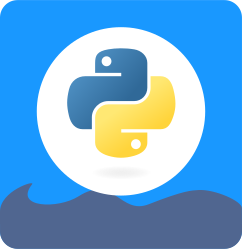

<!-- header:start -->

#  GitHub Action: Audit Python

<div align="center">
  
</div>

---

<!-- header:end -->

<!-- jscpd:ignore-start -->
<!-- Generated repository badges repeat across references. -->

<!-- badges:start -->

[](https://github.com/marketplace/actions/audit-python)
[](https://github.com/hoverkraft-tech/ci-github-python/releases)
[](http://choosealicense.com/licenses/mit/)
[](https://img.shields.io/github/stars/hoverkraft-tech/ci-github-python?style=social)
[](https://github.com/hoverkraft-tech/ci-github-python/blob/main/CONTRIBUTING.md)

<!-- badges:end -->

<!-- jscpd:ignore-end -->

<!-- overview:start -->

## Overview

Audit locked production dependencies with pip-audit.

The action exports the selected environment from `uv.lock` with hashes and
audits it with `pip-audit --require-hashes --disable-pip`. Development groups
and the project itself are excluded. Registry dependencies with hashes are
supported; direct VCS or editable dependencies may require a project-specific
audit workflow. Vulnerability lookup requires network access and scanner failures
fail the action. Dependency metadata is not rewritten.

<!-- jscpd:ignore-start -->
<!-- Shared setup and reporting guidance for standalone actions. -->

Run [setup-python](../setup-python/README.md) first with the same `working-directory`.

See the [continuous integration workflow](../../.github/workflows/continuous-integration.md) for orchestration and version matrices.

<!-- jscpd:ignore-end -->

<!-- overview:end -->

<!-- jscpd:ignore-start -->
<!-- Generated API reference repeats action and workflow metadata. -->

<!-- usage:start -->

## Usage

```yaml
- uses: hoverkraft-tech/ci-github-python/actions/audit@cd59232bc5455db2c034b00499a775411f1104b7 # fix/enforce-lint-checks
  with:
    # uv project directory.
    # Default: `.`
    working-directory: .
```

<!-- usage:end -->

<!-- inputs:start -->

## Inputs

| **Input**               | **Description**       | **Required** | **Default** |
| ----------------------- | --------------------- | ------------ | ----------- |
| **`working-directory`** | uv project directory. | **false**    | `.`         |

<!-- inputs:end -->

<!-- secrets:start -->
<!-- secrets:end -->

<!-- outputs:start -->
<!-- outputs:end -->

<!-- jscpd:ignore-end -->

<!-- examples:start -->
<!-- examples:end -->

<!-- jscpd:ignore-start -->
<!-- Generated repository and tool boilerplate repeats across references. -->

<!-- contributing:start -->

## Contributing

Contributions are welcome! Please see the [contributing guidelines](https://github.com/hoverkraft-tech/ci-github-python/blob/main/CONTRIBUTING.md) for more details.

<!-- contributing:end -->

<!-- security:start -->
<!-- security:end -->

<!-- license:start -->

## License

This project is licensed under the MIT License.

SPDX-License-Identifier: MIT

Copyright © 2026 hoverkraft

For more details, see the [license](http://choosealicense.com/licenses/mit/).

<!-- license:end -->

<!-- generated:start -->

---

This documentation was automatically generated by [CI Dokumentor](https://github.com/hoverkraft-tech/ci-dokumentor).

<!-- generated:end -->

<!-- jscpd:ignore-end -->
